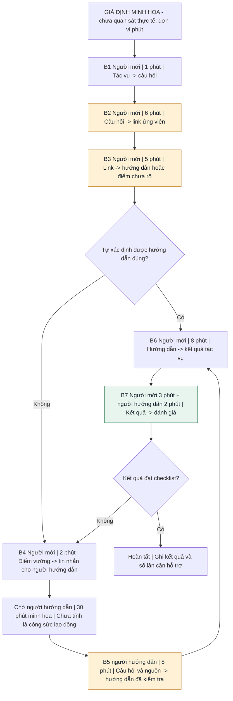
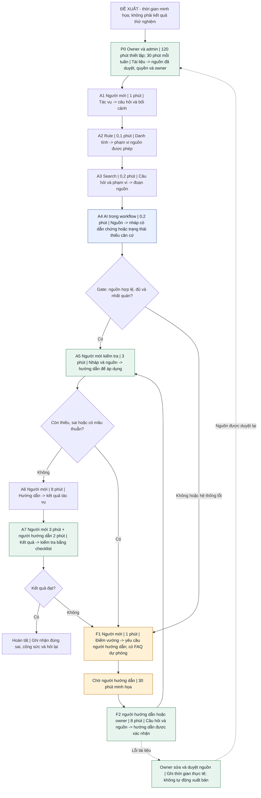

# Báo cáo nhóm — Day 02 Discovery & Problem Framing

> Bản chung của nhóm, viết trên repo do nhóm trưởng fork. Không copy file này sang repo cá nhân.
> Template chi tiết và prompt mẫu: [docs/01-worksheet.md](../../docs/01-worksheet.md). Bài mẫu: [docs/02-deliverable-example.md](../../docs/02-deliverable-example.md).

## 1. Thông tin nhóm

- Tên nhóm:
- Thành viên: xem `TEAM.md`
- Candidate problem được chọn (1 câu):
- Quyết định cuối: Go / Not Yet / No-Go

---

## 2. Hội tụ nhóm (CP3)

### 2.1. Pitch

| # | Người đưa ra | Candidate (Job Story ngắn) | Actor | Bottleneck | Câu hỏi phản biện nhận được (ai hỏi) |
|---:|---|---|---|---|---|
| 1 |  Nguyễn Lương Nguyên | Khi kết thúc mỗi ngày làm việc, tôi muốn tổng hợp tiến độ công việc của từng thành viên trong team dev, để nắm bắt tình hình thực hiện công việc và kịp thời phát hiện các vấn đề ảnh hưởng đến tiến độ chung. | Team Leader, Team Members | Tổng hợp thông tin báo cáo (Bước 2 -> 4) mất 25 phút | Việc tổng hợp báo cáo tiến độ mất khoảng 20 phút mỗi ngày có thực sự là bottleneck đáng ưu tiên giải quyết, hay phần lớn thời gian này vẫn cần thiết để Team Leader kiểm tra và xác nhận thông tin? Nếu rút ngắn thời gian tổng hợp, liệu có cải thiện đáng kể hiệu quả quản lý tiến độ của team không? (Bùi Đức Hiếu) |
| 2 | Nguyễn Lương Nguyên | Khi hoàn thành code một chức năng, tôi muốn cập nhật đầy đủ thông tin chức năng đó vào tài liệu đặc tả, để đảm bảo tài liệu phản ánh đúng trạng thái hiện tại của hệ thống và hỗ trợ các thành viên team dev trong quá trình phát triển, bảo trì. | Team Members, Team Leader | Bước 3, cập nhật nội dung: 15 phút | |
| 3 | Nguyễn Lương Nguyên | Khi đến cuối mỗi tháng, tôi muốn tổng hợp phản hồi và kết quả khảo sát người dùng từ nhiều ứng dụng, để xác định các vấn đề, nhu cầu cần thêm và hạng mục cần cải thiện cho từng ứng dụng. | Team Leader | Phân tích kết quả (Bước 1->5 ) | |
| 4 | Bùi Đức Hiếu | Khi kết thúc một cuộc họp nhóm, tôi muốn xác định các quyết định, công việc được giao và deadline, để mọi người có thể tiếp tục công việc mà không phải hỏi lại | Team leader, Thư ký/Project coordinator, Team members | Xác định đầy đủ task, member phụ trách và dl từ ND thảo luận | |
| 5 | Bùi Đức Hiếu | Khi nhận một đề bài nhóm có nhiều yêu cầu, tôi muốn chia nhỏ yêu cầu thành các đầu việc có người phụ trách và deadline, để cả nhóm hiểu rõ trách nhiệm và không bỏ sót deliverable | Team leader, Team members | Convert yêu cầu tổng quát thành deliverable, task cụ thể, có scope và trách nhiệm rõ ràng | Việc không rõ người phụ trách có thường xuyên xảy ra không? Hay các thành viên vẫn tự hiểu và chủ động nhận việc? (Nguyễn Lương Nguyên) |
| 6 | Bùi Đức Hiếu | Khi gặp lại một khái niệm hoặc dạng bài đã học, tôi muốn tìm được ghi chú và lời giải liên quan trước đó, để không phải đọc lại toàn bộ tài liệu hoặc giải quyết lại vấn đề từ đầu | Sinh viên có nhiều tài liệu, ghi chú và bài tập được lưu trữ ở nhiều nơi | Tìm kiếm và xác định tài liệu phù hợp trong số lượng lớn tài liệu được lưu trữ, đặc biệt khi không nhớ chính xác tên file hoặc vị trí lưu (có thể chiếm 5 - 10p) | |
| 7 | Hoàng Nhật Minh | Khi nhân viên mới vào team, tôi muốn họ tự tìm được tài liệu và quy trình nội bộ, để người cũ không phải trả lời cùng một câu nhiều lần | Người cũ / mentor bị hỏi; nhân viên mới (người hỏi) | Bước 2–3: tự tìm mất 20 phút rồi vẫn phải hỏi, vì tài liệu rải rác và nhân viên mới không biết từ khóa nội bộ. Bước 5: người cũ mất 10-15 phút mỗi lần bị hỏi | |
| 8 | Hoàng Nhật Minh | Khi nhận thông báo của trường từ nhiều nhóm chat, sổ liên lạc và email, phụ huynh muốn nắm được việc nào cần làm và hạn khi nào, để không lỡ hạn nộp tiền hay lịch họp | Phụ huynh có con tiểu học/THCS, ở nhiều nhóm chat (lớp, trường, ban đại diện) | Bước 3: tìm ra vài tin cần hành động giữa hàng chục đến hàng trăm tin khác. Mất 30-60 phút/ngày, hoặc bỏ qua luôn khi đã tắt thông báo | |
| 9 | Hoàng Nhật Minh | Khi khách nhắn hỏi lặp lại về giá, size, phí ship, chủ shop online muốn trả lời nhanh và đúng, để không mất khách vì phản hồi chậm | Chủ shop hoặc nhân viên trực inbox của shop nhỏ (1–3 người) bán qua Facebook/Zalo | Bước 2: thời gian từ lúc khách nhắn đến lúc shop trả lời là 90 phút vào giờ cao điểm. Bước 4–5: gõ lại cùng một nội dung 20 lần/ngày | |
| 10 | Trần Trung Kiên | Khi phải mua thuốc ngoài vì bệnh viện hết thuốc, tôi muốn biết điều kiện và giấy tờ cần để được thanh toán, để tránh bỏ sót quyền lợi hoặc bổ sung hồ sơ nhiều lần. | Bệnh nhân/người nhà chuẩn bị hồ sơ; nhân viên tài chính bệnh viện. | Dự kiến: đối chiếu hướng dẫn với trường hợp cá nhân để xác định điều kiện và giấy tờ còn thiếu. | Khó khăn chính là không hiểu điều kiện thanh toán hay đã nộp đủ hồ sơ nhưng xử lý chậm? Có trường hợp thực tế nào giúp phân biệt hai vấn đề này?|
| 11 | Trần Trung Kiên | Khi tìm mua hoặc thuê nhà qua nhiều môi giới, tôi muốn nhận biết căn mình đã hỏi hoặc đã xem, để tránh liên hệ và hẹn xem trùng. | Khách tìm mua/thuê nhà; nhân viên môi giới. | Dự kiến: đối chiếu các tin đăng để nhận diện cùng một căn khi ảnh, mô tả hoặc địa chỉ khác nhau hay không đầy đủ. | Nhiều môi giới đăng cùng một căn có thực sự khiến khách liên hệ hoặc đi xem trùng không? Có bằng chứng về thời gian mất thêm và cách xác nhận đó là cùng một căn không? |
| 12 | Trần Trung Kiên | Khi sắp xếp các đơn giao trong cùng ca, tôi muốn chọn thứ tự phù hợp với vị trí và giờ nhận hàng, để hạn chế quay lại khu vực đã đi qua và giao trễ. | Shipper; nhân viên điều phối vận chuyển. | Dự kiến: sắp thứ tự điểm giao đồng thời xét vị trí và khung giờ nhận của khách. | Việc quay lại khu vực cũ do sắp thứ tự chưa phù hợp hay do khách đổi giờ, vắng mặt hoặc đơn phát sinh? Shipper có quyền tự thay đổi thứ tự giao không? | |

### 2.2. Cluster

| Cluster | Các candidate | Pattern chung |
|---|---|---|
|A — Tìm kiếm và tái sử dụng tri thức Tìm kiếm và tái sử dụng tri thức|#2. Cập nhật tài liệu đặc tả sau code; #6. Lookup kiến thức đã học; #7. Nhân viên mới tự tìm tài liệu và quy trình nội bộ |Thông tin đã tồn tại nhưng người cần sử dụng khó tìm thấy, khó xác định tính phù hợp hoặc chưa biết cách tiếp cận |
|B — Điều phối và phân chia công việc|#1. Tổng hợp tiến độ team; #4. Xác định task và deadline sau cuộc họp; #5. Chia nhỏ đề bài thành task có người phụ trách |Thông tin về công việc và trách nhiệm chưa được chuyển hóa thành trạng thái hoặc đầu việc rõ ràng, gây khó khăn cho việc phối hợp |
|C — Tổng hợp thông tin phục vụ quyết định|#3. Tổng hợp phản hồi người dùng từ nhiều ứng dụng; #8. Theo dõi thông báo trường học qua nhiều kênh |Thông tin quan trọng nằm rải rác ở nhiều nguồn, khiến người dùng mất thời gian lọc, tổng hợp và xác định việc cần thực hiện |
|D — Vận hành dịch vụ và phân bổ nguồn lực|#9. Trả lời câu hỏi lặp lại của khách hàng; #10. Xử lý yêu cầu thanh toán thuốc; #11. Tránh trùng lặp môi giới bất động sản; #12. Tối ưu tuyến đường giao hàng |Quy trình cung cấp dịch vụ còn phát sinh thao tác lặp lại, chậm trễ hoặc phân bổ nguồn lực chưa hiệu quả |

### 2.3. Opportunity Solution Tree rút gọn

Gốc là **1 outcome**. Nhánh là **opportunity** (nhu cầu, pain), không phải tính năng hay công cụ.

```text
OUTCOME: Giảm thời gian người cũ / mentor dành cho việc trả lời các câu hỏi
lặp lại của nhân viên mới trong quá trình onboarding
├── Opportunity A: Tài liệu và quy trình nội bộ nằm ở nhiều nơi khác nhau
├── Opportunity B: Nhân viên mới không biết từ khóa hoặc thuật ngữ
│   nội bộ để tìm kiếm thông tin
└── Opportunity C: Nhân viên mới không chắc thông tin tìm được
    có chính xác, đầy đủ và còn hiệu lực hay không
```

Những ý đã gạch bỏ vì là solution đội lốt opportunity:

- Xây dựng một kho tài liệu onboarding tập trung.
- Xây dựng chatbot RAG để tìm kiếm và trả lời tài liệu nội bộ

### 2.4. Chấm điểm shortlist (1–5)

| Candidate | Actor rõ | Quy trình rõ | Pain có bằng chứng | Impact đo được | Vừa sức lab | So sánh được No AI/Rule/Workflow/Agent | Nhóm hiểu domain | Tổng |
|---|---:|---:|---:|---:|---:|---:|---:|---:|
|#7. Nhân viên mới tự tìm tài liệu và quy trình nội bộ |5 |4 |3 |4 |4 |5 |4 |29 |
|#6. Lookup kiến thức đã học |4 |4 |2 |3 |5 |5 |4 |27 |
|#9. Trả lời câu hỏi lặp lại của khách hàng |4 |4 |3 |4 |4 |5 |2 |26 |

**Candidate được chọn: Nhân viên mới tự tìm tài liệu và quy trình nội bộ**

**Vì sao chọn: Chọn #7 vì có actor, quy trình và impact rõ ràng, pain có thể đo lường qua thời gian tìm kiếm và trả lời câu hỏi lặp lại. Phạm vi phù hợp với năng lực nhóm, đồng thời cho phép so sánh hiệu quả giữa các giải pháp.**

**Vì sao loại các candidate còn lại: Lookup kiến thức gặp phải vấn đề khó chuẩn hóa hệ thống tài liệu cá nhân, trong khi việc trả lời câu hỏi lặp lại thì nhóm chưa có cơ hội tiếp xúc với domain cskh shop online, dẫn đến việc khó kiểm chứng**

**Xử lý bất đồng (nếu có):**

---

## 3. Kiểm chứng + research giải pháp đã có (CP4)

### 3.1. Assumption Map

| # | Giả định | Loại (Value / Usability / Feasibility / Viability) | Quan trọng (1–5) | Đã có bằng chứng (1–5) | Kiểm chứng trước? |
|---:|---|---|---:|---:|---|
| 1 | Nhân viên mới thường xuyên gặp khó khăn trong việc tìm kiếm tài liệu và quy trình nội bộ khi bắt đầu công việc. | Value | 5 | 1 | Có |
| 2 | Nhân viên cũ đang mất nhiều thời gian trả lời những câu hỏi lặp lại từ nhân viên mới. | Viability | 5 | 3 | Có |
| 3 | Các tài liệu và quy trình nội bộ hiện đang phân tán ở nhiều nơi, khó tìm kiếm hoặc chưa được tổ chức thống nhất. | Feasibility | 4  | 2 | Có |
| 4 | Nếu có một nơi tập trung tài liệu, quy trình và hướng dẫn, nhân viên mới sẽ chủ động tìm kiếm trước khi hỏi người cũ. | Desirability | 5 | 1 | Có |
| 5 | Team có thể duy trì, cập nhật tài liệu và quy trình thường xuyên để đảm bảo thông tin luôn chính xác, hữu ích. |  Feasibility | 3 | 2 | Không |

Giả định nhóm kiểm chứng trong buổi này: 1, 2 ,3 ,4

### 3.2. Kiểm chứng

Cách đã dùng: Phỏng vấn / Survey

Tổng hợp:

| Nguồn | Số người / số mẫu | Tín hiệu xác nhận | Tín hiệu phản bác |
|---|---:|---|---|
| Phỏng vấn | 3 | 3/3 người nói họ sẽ tự chủ động tìm thông tin nếu có tài liệu đầy đủ | 1/3 người nói họ không gặp khó khăn gì trong quá trình onboarding |
| Phỏng vấn | 2 | 1/2 người nói trả lời intern làm mất nhiều thời gian của họ | 1/2 người nói tài liệu, quy trình onboarding của họ đã chuẩn |

**Nhóm đã sửa problem thế nào sau kiểm chứng:**
Sửa từ "Chuẩn hóa quy trình onboarding nhân viên" sang thành "Xây dựng kho tài liệu onboarding tập trung.", có thể mở rộng thêm sang "Xây dựng hệ thống AI RAG hỗ trợ onboarding" sau khi hoàn thành xây dựng kho tài liệu.

### 3.3. Research giải pháp đã có


**Bảng research**

| Công cụ / link đã mở | Chức năng xác nhận được | Bước quy trình được hỗ trợ | Phần còn cần team giải quyết / kiểm chứng | Hàm ý cho nhóm |
|---|---|---|---|---|
| **Notion Enterprise Search** — [S1](https://www.notion.com/help/enterprise-search) | Tìm trong workspace và nguồn kết nối như Slack, Google Drive, Jira; trả lời có trích dẫn; cho phép giới hạn nguồn tìm kiếm | Tìm tài liệu và tổng hợp câu trả lời, tương ứng B2–B3 và một phần B5 | Phải cấu hình nguồn và chọn đúng chế độ tìm nội bộ. Tài liệu này chưa chứng minh người mới của team hoàn thành tác vụ độc lập tốt hơn. Tri thức chưa được viết ra và phê duyệt nghiệp vụ vẫn cần người phụ trách | Nếu team đang dùng Notion, thử trên bộ câu hỏi thật trước khi xây mới; tắt tìm web cho bài thử quy trình nội bộ |
| **Confluence — Rovo Search** — [S2](https://support.atlassian.com/confluence-cloud/docs/use-atlassian-intelligence-to-search-for-answers/) | Hỏi bằng ngôn ngữ tự nhiên; trả lời dựa trên thông tin được truy cập; có link nguồn và phản hồi. Tài liệu nêu kết quả tốt nhất khi nguồn đầy đủ và cập nhật | B2–B3; hỗ trợ người hướng dẫn ở B5 | Nguồn cũ, thiếu ngữ cảnh và quy trình cần người phê duyệt không tự trở nên đúng nhờ tìm kiếm. Chất lượng tiếng Việt/thuật ngữ của team và phạm vi dữ liệu thực tế phải kiểm tra | Hợp với team đã dùng Confluence. Kiểm tra quyền và câu không có đáp án; không giả định mọi câu hỏi đều chỉ dùng tri thức nội bộ vì tài liệu cũng nêu xử lý định nghĩa chung từ dữ liệu huấn luyện |
| **Guru — Search & Chat + Verification** — [S3](https://help.getguru.com/docs/searching-for-knowledge-in-guru), [S4](https://help.getguru.com/docs/what-is-verifcation) | Hỏi đáp có trích dẫn; tìm Cards và nguồn kết nối; lọc theo trạng thái xác minh. Có cơ chế người được chỉ định xác minh nội dung, đặt hạn; có cả xác minh tự động | B2–B3, phần xác nhận nguồn ở B5; quản trị nguồn P0 trong quy trình mới | Team vẫn phải có người đủ thẩm quyền xác nhận nội dung quan trọng. Nhãn đã xác minh không thay thế kiểm tra đáp án trên tác vụ thật. Chi phí duy trì và mức phù hợp với team chưa đo | Không dùng “có nguồn, có kiểm chứng” làm khác biệt mới vì sản phẩm này đã có; học pattern owner + trạng thái nguồn + chuyển người |

**Kết luận và hướng thu hẹp problem cần kiểm chứng**

**Kết luận đã có cơ sở:** tìm kiếm và hỏi đáp tri thức nội bộ là nhóm giải pháp đã tồn tại. Chưa có cơ sở để xây chatbot mới chỉ vì nhân viên hỏi lặp.

**Hướng thu hẹp cần kiểm chứng:** người mới của team X vẫn không hoàn thành đúng các tác vụ thường gặp bằng tài liệu và công cụ hiện có; cần xác định phần thất bại nằm ở tìm kiếm, diễn giải, chất lượng nguồn hay quyền truy cập.

Trước khi chọn giải pháp, chạy cùng một bộ 20 câu hỏi thật bằng: (1) FAQ/mục lục và search hiện có; (2) công cụ sẵn có của team nếu được cấp quyền; (3) workflow đề xuất nếu hai cách trước chưa đủ. Dùng người chấm, nhiệm vụ và tiêu chí tương đương; tránh để một người vừa xem đáp án ở lượt trước rồi làm lại cùng câu ở lượt sau.

**Tín hiệu phản bác cần tìm, chưa phải kết quả:** nếu người mới tìm đúng hướng dẫn nhanh nhưng chờ cấp quyền hoặc phê duyệt, bottleneck không phải tìm kiếm. Nếu FAQ đạt mục tiêu, chọn FAQ. Nếu tài liệu sai, sửa quản trị nguồn trước.

---

## 4. Quy trình trước/sau (CP5)

**Đơn vị phân tích và quy ước thời gian**

Một lượt = một người mới gặp một câu hỏi trong lúc làm một tác vụ onboarding. Điểm kết thúc là tác vụ được kiểm tra đạt, không phải chatbot gửi xong câu trả lời.

- **Phút người mới / phút người hướng dẫn:** thời gian lao động chủ động. Cộng hai loại thành tổng người-phút.
- **Phút chờ:** khoảng không có người đang xử lý; tính vào thời gian trôi qua, không cộng vào người-phút.
- **Phút hệ thống:** độ trễ xử lý; tính vào thời gian trôi qua.
- Các tổng dưới đây giả sử các hoạt động diễn ra nối tiếp, một lần thực hiện, không có vòng làm lại. Khi thử thật phải lấy timestamp và ghi số vòng riêng.

### 4.1. Quy trình hiện tại — giả định để xác nhận



| ID | Bước / actor | Input | Output | Thời gian minh họa | Tần suất |
|---|---|---|---|---|---|
| B1 | Người mới xác định câu hỏi | Tác vụ được giao | Câu hỏi cần hướng dẫn | 1 phút người mới | Mỗi lượt |
| B2 | Người mới tìm kiếm | Câu hỏi, từ khóa, kho tài liệu | Link ứng viên | 6 phút người mới | Mỗi lượt |
| B3 | Người mới đọc, chọn hướng dẫn | Link ứng viên | Hướng dẫn áp dụng hoặc điểm chưa rõ | 5 phút người mới | Mỗi lượt |
| B4 | Người mới hỏi người hướng dẫn nếu chưa rõ | Điểm vướng, tác vụ, link đã thử | Tin nhắn đủ bối cảnh | 2 phút người mới | Nhánh cần hỗ trợ |
| W | Chờ người hướng dẫn | Tin nhắn đã gửi | người hướng dẫn bắt đầu xử lý | 30 phút chờ, 0 người-phút | Nhánh cần hỗ trợ |
| B5 | người hướng dẫn kiểm tra nguồn và giải thích | Câu hỏi + tài liệu | Hướng dẫn đã được kiểm tra | 8 phút người hướng dẫn | Nhánh cần hỗ trợ |
| B6 | Người mới thực hiện | Hướng dẫn | Kết quả tác vụ | 8 phút người mới | Mỗi lượt |
| B7 | Người mới tự kiểm, người hướng dẫn kiểm kết quả | Kết quả + checklist | Đạt hoặc yêu cầu làm lại | 3 phút người mới + 2 phút người hướng dẫn | Mỗi lượt trong pilot |

Nếu B3 đủ rõ: bỏ B4/W/B5 và đi thẳng B6. Nếu B7 chưa đạt: trở lại B4. B7 kiểm tra sản phẩm công việc; khác với việc người hướng dẫn trả lời câu hỏi hướng dẫn ở B5.

**Bottleneck giả định:** B2–B3 không tạo được hướng dẫn đáng tin cậy, làm phát sinh B4–B5 và chờ W. Cần log chứng minh câu hỏi lặp có đáp án trong nguồn đúng; nếu không, chuyển trọng tâm sang chất lượng tài liệu.

### 4.2. Quy trình tương lai — workflow có điều kiện



| ID | Bước / cơ chế | Input | Output | Thời gian minh họa | Tần suất |
|---|---|---|---|---|---|
| P0 | Owner duyệt nội dung; admin cấu hình quyền — **Human** | Nguồn, vai trò, chính sách truy cập | Nguồn hợp lệ, owner, phiên bản, phạm vi quyền | 120 người-phút ban đầu; 30 người-phút/tuần duy trì | Trước pilot và định kỳ, không phải mỗi câu |
| A1 | Người mới đặt câu hỏi — **Human** | Tác vụ, bối cảnh | Câu hỏi đủ ngữ cảnh | 1 phút người mới | Mỗi lượt |
| A2 | Xác định quyền — **Rule** | Danh tính, quyền tại nguồn | Phạm vi tài liệu được phép | 0,1 phút hệ thống | Mỗi lượt |
| A3 | Tìm kiếm trong phạm vi — **Search** | Câu hỏi + phạm vi | Đoạn nguồn liên quan | 0,2 phút hệ thống | Mỗi lượt |
| A4 | Soạn nháp — **AI trong workflow** | Câu hỏi + đoạn nguồn | Hướng dẫn có nguồn hoặc trạng thái thiếu căn cứ | 0,2 phút hệ thống | Mỗi lượt |
| Gate | Kiểm tra điều kiện trả lời — **Rule + tín hiệu AI cần kiểm chứng** | Nháp, nguồn, trạng thái | Cho xem nháp hoặc chuyển người | Gộp trong 0,2 phút A4 | Mỗi lượt |
| A5 | Người mới kiểm link và mức phù hợp — **Human** | Nháp + nguồn được truy cập | Hướng dẫn có thể áp dụng hoặc phản ánh lỗi | 3 phút người mới | Mỗi lượt |
| F1 | Fallback: người mới gửi yêu cầu hỗ trợ — **Human** | Câu hỏi, lỗi, nguồn đã thử | Tin nhắn cho người hướng dẫn; link FAQ/mục lục | 1 phút người mới | Khi thiếu nguồn, lỗi hoặc còn nghi ngờ |
| W | Chờ người hướng dẫn | Yêu cầu hỗ trợ | người hướng dẫn bắt đầu | 30 phút chờ | Nhánh ngoại lệ |
| F2 | người hướng dẫn/owner xác minh — **Human** | Câu hỏi, nguồn, nháp nếu có | Hướng dẫn được xác nhận | 8 phút người hướng dẫn | Nhánh ngoại lệ |
| A6 | Người mới thực hiện — **Human** | Hướng dẫn | Kết quả tác vụ | 8 phút người mới | Mỗi lượt |
| A7 | Người mới tự kiểm, người hướng dẫn kiểm — **Human** | Kết quả + checklist | Đạt hoặc phải làm lại | 3 phút người mới + 2 phút người hướng dẫn | Mỗi lượt trong pilot |

Nhánh thông thường: A1 → A2 → A3 → A4 → Gate → A5 → A6 → A7. Nhánh ngoại lệ được tính ở bảng so sánh là Gate chuyển F1 → W → F2 → A5 → A6 → A7. Nếu lỗi chỉ được phát hiện sau khi đọc A5, cộng thêm 3 phút đọc đã mất. Mọi vòng làm lại phải cộng thời gian thực tế, không nằm trong tổng minh họa.

**Gate không phải “AI chắc chắn đúng”:** Rule kiểm nguồn có tồn tại, quyền, trạng thái duyệt, trích dẫn. Phát hiện thiếu căn cứ/mâu thuẫn bằng AI là tín hiệu có thể sai; phải kiểm tra bằng eval và giữ A5/A7. Không dùng riêng điểm tự tin do mô hình tự khai để quyết định trả lời.

**HITL:** owner duyệt nguồn trước; người mới mở nguồn và báo điểm không rõ; người hướng dẫn kiểm kết quả mọi tác vụ trong pilot bằng checklist. Không giao toàn bộ trách nhiệm phát hiện sai cho người mới.

**Boundary:** hệ thống chỉ đọc dữ liệu được cấp quyền; không tự cấp quyền, sửa/xuất bản tài liệu, gửi tin thay người dùng, chạy thao tác nghiệp vụ, phê duyệt hoặc đánh giá thử việc. Không dùng kiến thức web để suy ra quy trình công ty. Các yêu cầu phê duyệt đang có vẫn giữ nguyên.

**Fallback cụ thể:** khi không có nguồn đúng, nguồn mâu thuẫn, link không truy cập được, người mới phản ánh sai hoặc dịch vụ lỗi: không đưa hướng dẫn mang tính khẳng định; hiển thị FAQ và đầu mối người hướng dẫn/owner. Người mới gửi câu hỏi cùng nguồn đã thử. Không có quyền thì admin xử lý yêu cầu theo quy trình hiện tại; tuyệt đối không bỏ qua quyền để trả lời. Owner sửa nguồn rồi duyệt trước khi sử dụng lại.

### 4.3. Before / after — cùng một tác vụ, số liệu minh họa

Đếm bước xử lý, không đếm nút quyết định, trạng thái chờ và hoàn tất; P0 là công việc định kỳ riêng. A4 gồm gate tự động. Bước thủ công là bước có người thao tác, dù có dùng máy tính.

| Chỉ tiêu | Trước: cần người hướng dẫn trả lời | Trước: tự tìm được | Sau: nhánh thường | Sau: ngoại lệ phát hiện tại Gate |
|---|---:|---:|---:|---:|
| Số bước xử lý | 7 | 5 | 7 | 9 |
| Số bước có người thao tác | 7 | 5 | 4 | 6 |
| Phút người mới | 25 | 23 | 15 | 16 |
| Phút người hướng dẫn | 10 | 2 | 2 | 10 |
| Tổng người-phút | 35 | 25 | 17 | 26 |
| Phút hệ thống tính riêng | Chưa đo riêng | Chưa đo riêng | 0,5 | 0,5 |
| Phút chờ người hướng dẫn | 30 | 0 | 0 | 30 |
| Tổng thời gian trôi qua minh họa | 65 | 25 | 17,5 | 56,5 |
| Công sức quản trị nguồn | Chưa đo, không mặc định bằng 0 | Như bên trái | P0 và xử lý lỗi | P0 và xử lý lỗi |
| Rủi ro chính | Chờ lâu, nguồn cũ, hướng dẫn không được lưu | Tự chọn sai nguồn | Nháp sai nhưng thuyết phục; sai quyền; người mới tin quá mức | Vừa mất công thử AI vừa phải hỏi; chuyển sai owner |

Không thể lấy 65 → 17,5 phút làm mức tiết kiệm đại diện vì hai cột là hai nhánh khác nhau. Gọi q là tỷ lệ trước đây cần người hướng dẫn, p là tỷ lệ sau phải fallback tại Gate, và giả sử chưa có vòng làm lại:

- Người-phút trước mỗi lượt: **25 + 10q**.
- Người-phút sau mỗi lượt: **17 + 9p**.
- Sau đó cộng chênh lệch công sức duy trì, chi phí thiết lập phân bổ, lượt phát hiện lỗi ở A5 và các vòng làm lại.

Các công thức chỉ là mô hình dựa trên số phút minh họa; p, q và thời gian từng bước phải đo. Việc A6 vẫn giữ 8 phút ở cả hai quy trình thể hiện AI chưa làm tác vụ thay người mới.

### 4.4. Cách thay số minh họa bằng baseline


| Metric | Baseline hiện tại | Target đề xuất trước pilot | Cách đo |
|---|---|---|---|
| Câu hỏi lặp cần người hướng dẫn giải thích/người mới/tuần | Chưa đo | Giảm ít nhất 30% | Nhóm câu hỏi theo ý nghĩa; chuẩn hóa theo số người mới |
| Tổng người-phút hỗ trợ và duy trì/người mới/tuần | Chưa đo | Giảm ít nhất 25% | Log người hướng dẫn + sửa nguồn + vận hành; báo chi phí thiết lập riêng |
| Tỷ lệ tác vụ đạt lần đầu | Chưa đo | Không thấp hơn baseline | người hướng dẫn chấm cùng checklist |
| Ngày đạt mốc độc lập | Chưa đo | Chưa chốt trước khi có baseline | Mốc: 3 tác vụ chuẩn đạt mà không cần hướng dẫn từng bước; kiểm duyệt thông thường vẫn được phép |

Không đồng nhất “giảm câu hỏi” với “hiểu tốt hơn”. Nếu ít hỏi nhưng làm sai nhiều hơn, phương án không đạt.

---

## 5. Problem Statement v0 (CP5)

| Trường | Nội dung |
|---|---|
| **Actor** | Nhân viên cũ / mentor trong team, là người thường xuyên bị nhân viên mới hỏi trong 2 tuần đầu onboarding |
| **Quy trình** | Nhân viên mới cần làm một việc (xin quyền truy cập, setup môi trường, nộp chứng từ…) → tự tìm trên Drive / wiki / kênh chat → không tìm ra hoặc không chắc tài liệu còn đúng → nhắn hỏi người cũ → người cũ dừng việc để tìm link hoặc giải thích lại → nhân viên mới làm tiếp |
| **Bottleneck** | Bước tự tìm: tài liệu nằm rải rác nhiều nơi, nhân viên mới không biết từ khóa nội bộ hay bản nào mới nhất, nên chuyển sang hỏi người |
| **Impact** | Người cũ bị ngắt việc 5 lần/tuần, mất 60 phút/tuần cho các câu đã từng trả lời. Nhân viên mới chờ trung bình 20 phút mỗi câu và có lúc bị chặn việc |
| **Success Metric** (baseline → target, cách đo) | Số câu hỏi lặp lại người cũ nhận mỗi tuần, tính trên mỗi nhân viên mới: ⟨baseline⟩ → giảm ≥ 50%. Đo bằng cách đếm tin nhắn hỏi trong chat/DM của người cũ, 2 tuần trước pilot và 4 tuần pilot. Một câu được tính là "lặp lại" nếu câu trả lời đã có trong tài liệu hoặc đã từng được trả lời |
| **Boundary** (AI không được làm gì; khi nào cần con người kiểm tra — HITL) | AI không trả lời ngoài tài liệu nội bộ đã duyệt, không trả lời thiếu link nguồn, không tự cấp quyền hay duyệt yêu cầu. Chuyển cho người phụ trách khi: không tìm thấy nguồn, các nguồn mâu thuẫn, hoặc câu hỏi về quyền truy cập, bảo mật, HR, lương |


Phản biện nhận được (từ AI hoặc nhóm khác) và nhóm có đồng ý không:
Tại sao không sử dụng các ứng dụng tổng hợp nội dung như noteLM?

-
Phản biện: Chi phí mỗi lần truy xuất lớn hơn, tính bảo mật thấp hơn.

---


## 6. Mức can thiệp AI (CP6)

### 6.1. Ma trận độ mơ hồ × độ phức tạp

Bài của nhóm nằm ở ô: Độ phức tạp thấp × độ mơ hồ cao

Vì sao:
- Độ mơ hồ cao ở đầu vào: nhân viên mới hỏi bằng ngôn ngữ tự nhiên, mỗi người hỏi một kiểu và không biết từ khóa nội bộ. Đầu ra thì có đúng/sai rõ: câu trả lời phải khớp với tài liệu.
- Độ phức tạp thấp: chỉ có 1 bước chính (tìm đúng tài liệu rồi tóm tắt kèm link), 1 nguồn là kho tài liệu nội bộ, không có bước nào phụ thuộc bước trước.

### 6.2. So sánh 4 mức

| Mức | Phương án cho bài của nhóm | Đủ khi nào | Rủi ro | Chọn? |
|---|---|---|---|---|
| **No AI** (sửa quy trình) | Gom tài liệu về 1 trang onboarding, có mục lục và FAQ top câu hỏi. Có checklist tuần đầu. Người cũ trả lời bằng link, gặp câu mới thì bổ sung vào FAQ | Câu hỏi tập trung vào một nhóm nhỏ, nhân viên mới tìm được bằng mục lục | FAQ lỗi thời nếu không ai giữ. Nhân viên mới vẫn không tìm ra vì không biết từ khóa | **Có, làm nền.** Workflow cũng cần kho tài liệu sạch |
| **Rule** | Bot trả lời theo từ khóa trong kênh onboarding: câu hỏi chứa từ khóa thì gửi link FAQ tương ứng | Câu hỏi dùng từ khóa ổn định, ít cách diễn đạt | Khớp sai hoặc không khớp khi nhân viên mới dùng từ khác | Không, vì bottleneck chính là không biết từ khóa |
| **Workflow** | Câu hỏi → tìm trong kho tài liệu đã duyệt → AI trả lời ngắn kèm link nguồn → Rule chặn chủ đề nhạy cảm và câu không có nguồn, chuyển cho người phụ trách → nhân viên mới bấm "đã giải quyết / chưa" → câu "chưa" được đưa vào FAQ | Các bước cố định, AI chỉ làm phần hiểu câu hỏi và tóm tắt | Trả lời sai hoặc trích tài liệu cũ, nhân viên mới làm sai | **Chọn**, có điều kiện (xem dưới) |
| **Agent** | AI tự tìm trên nhiều hệ thống, tự tạo ticket, tự xin hoặc cấp quyền thay nhân viên mới | Khi bước tiếp theo không đoán trước được | Quyền truy cập rộng, khó kiểm soát, sai thì hậu quả thật (cấp quyền sai) | Không. Bài toán không cần AI tự quyết bước tiếp theo |


**Mức chọn:** Workflow, đặt trên nền No AI (gom và dọn tài liệu trước). Nếu bảng research 3.3 cho thấy công cụ nhóm đang dùng đã có sẵn tính năng hỏi đáp trên tài liệu, thì dùng công cụ đó thay vì tự xây.


**Vì sao không chọn mức đơn giản hơn:** No AI và Rule giải được phần tài liệu rải rác, nhưng không giải được phần nhân viên mới không biết từ khóa nội bộ. Workflow chỉ cần thiết khi CP4 cho thấy câu trả lời **đã có** trong tài liệu mà nhân viên mới vẫn không tìm ra: ⟨X / Y câu hỏi trong log hoặc phỏng vấn⟩. Nếu đa số câu hỏi chưa có trong tài liệu, thì vấn đề là thiếu tài liệu và nhóm dừng ở No AI.


### 6.3. AI Canvas rút gọn


| Thành phần | Nội dung |
|---|---|
| **Prediction** — AI dự đoán / tạo ra gì? | Tài liệu nào trả lời câu hỏi, kèm câu trả lời ngắn và link nguồn. Hoặc "không tìm thấy" |
| **Judgment** — con người cân nhắc, quyết định gì? | Nhân viên mới quyết định câu trả lời đã giải quyết được việc chưa. Người phụ trách tài liệu quyết định nội dung nào đúng, câu nào cần bổ sung hoặc sửa tài liệu |
| **Action** — hành động cuối cùng là gì, ai làm? | Nhân viên mới làm theo tài liệu gốc. Nếu chưa giải quyết thì hỏi người phụ trách. Người phụ trách cập nhật tài liệu hoặc FAQ |
| **Outcome** — đo kết quả bằng gì? | Số câu hỏi lặp lại người cũ nhận mỗi tuần; tỉ lệ câu trả lời đúng nguồn; tỉ lệ nhân viên mới bấm "đã giải quyết" |
| **Input** — AI cần dữ liệu đầu vào gì mỗi lần chạy? Có sẵn không? | Câu hỏi của nhân viên mới; kho tài liệu nội bộ đã duyệt (wiki, Drive, FAQ), mỗi tài liệu có người phụ trách và ngày cập nhật; danh sách chủ đề nhạy cảm kèm người phụ trách. |
| **Feedback** — lấy phản hồi ở đâu để cải thiện? | Nút "đã giải quyết / chưa"; các câu bị chuyển cho người; người cũ báo câu AI trả lời sai |


### 6.4. Hai câu hỏi của Google PAIR


- Người dùng muốn **được hỗ trợ (augment)** hay **giao hẳn việc (automate)**? Bằng chứng: **Augment.** Giao cho AI phần *tìm và tóm tắt*, còn nhân viên mới vẫn tự làm theo tài liệu gốc. Việc cấp quyền và các câu hỏi nhạy cảm vẫn do người làm. *Giả thuyết, cần CP4 xác nhận:* ⟨câu nói hoặc hành vi từ phỏng vấn, ví dụ nhân viên mới đã từng ngại hỏi nên tự đoán, hoặc người cũ đã từng gửi lại cùng một link⟩.
- AI sai kiểu nào tệ hơn, **báo nhầm** hay **bỏ sót**? Vì sao, và thiết kế đã xử lý thế nào: **Báo nhầm tệ hơn**, tức AI trả lời tự tin nhưng sai, ví dụ quy trình đã cũ hoặc thiếu bước. Nhân viên mới chưa đủ kinh nghiệm để nhận ra mình đang làm sai. Bỏ sót (AI nói "không tìm thấy") chỉ đưa quy trình về như hiện tại là hỏi người cũ. Vì vậy thiết kế chọn: không chắc thì chuyển cho người, bắt buộc kèm link nguồn, không trích tài liệu quá hạn.


---

## 7. Problem Statement v1 + tiêu chí đánh giá (CP6)


| Trường | Nội dung |
|---|---|
| **Actor** | Nhân viên cũ / mentor trong team, là người thường xuyên bị nhân viên mới hỏi trong 2 tuần đầu onboarding, ở team **mà câu trả lời đã có trong tài liệu** |
| **Quy trình** | Nhân viên mới cần làm một việc → tự tìm trên Drive / wiki / kênh chat → không tìm ra hoặc không chắc tài liệu còn đúng → nhắn hỏi người cũ → người cũ dừng việc để tìm link hoặc giải thích lại → nhân viên mới làm tiếp |
| **Bottleneck** | Bước tự tìm: tài liệu nằm rải rác, nhân viên mới không biết từ khóa nội bộ hay bản nào mới nhất, nên chuyển sang hỏi người |
| **Impact** | Người cũ bị ngắt việc 5 lần/tuần, mất 60 phút/tuần. Nhân viên mới chờ trung bình 20 phút mỗi câu |
| **Success Metric** (baseline → target, cách đo) | (1) Số câu hỏi lặp lại người cũ nhận mỗi tuần, tính trên mỗi nhân viên mới: ⟨baseline⟩ → giảm ≥ 50%. Đếm trong chat/DM, 2 tuần trước pilot và 4 tuần pilot. (2) **Tỉ lệ câu trả lời đúng nguồn ≥ 90%.** Người phụ trách kiểm ngẫu nhiên 20 câu mỗi tuần theo tiêu chí bên dưới. (3) **Không có sự cố** nhân viên mới làm sai do câu trả lời sai |
| **Boundary** | AI không trả lời ngoài tài liệu nội bộ đã duyệt, không trả lời thiếu link nguồn, **không trích tài liệu quá hạn hoặc chưa có người phụ trách**, không tự cấp quyền hay duyệt yêu cầu. Chuyển cho người phụ trách khi: không tìm thấy nguồn, các nguồn mâu thuẫn, hoặc câu hỏi về quyền truy cập, bảo mật, HR, lương |
| **AI intervention point** | Giữa bước "nhân viên mới tự tìm" và bước "hỏi người cũ": AI tìm tài liệu và tóm tắt kèm link trước khi câu hỏi đến tay người |
| **Mức chọn** | Workflow, trên nền No AI (gom tài liệu về 1 nơi, gắn người phụ trách và ngày cập nhật) |
| **Rủi ro & người kiểm tra** | Trả lời sai hoặc dùng bản cũ → người phụ trách tài liệu kiểm mẫu hằng tuần. Nhân viên mới làm theo sai → câu trả lời luôn kèm link để đối chiếu với bản gốc. Tài liệu lỗi thời → người phụ trách nhận nhắc rà lại sau ⟨X⟩ tháng |


**Thay đổi so với v0 và lý do:**


| Trường | v0 | v1 | Vì sao đổi |
|---|---|---|---|
| Success Metric | Chỉ đếm số câu hỏi lặp lại | Thêm tỉ lệ đúng nguồn và số sự cố | Nếu chỉ đếm số câu hỏi, AI trả lời sai vẫn làm metric "đẹp" vì nhân viên mới không hỏi lại.|
| Boundary | Không nói tới độ mới của tài liệu | Không trích tài liệu quá hạn hoặc chưa có người phụ trách | Bottleneck có nguyên nhân "không biết bản nào mới nhất". AI trích bản cũ sẽ lặp lại đúng lỗi đó |
| Actor | Mọi team có nhân viên mới | Chỉ team mà câu trả lời đã có trong tài liệu | Team thiếu tài liệu thì cần viết tài liệu (No AI), AI không giúp được |


**Tiêu chí đánh giá đầu ra của AI (3–5 tiêu chí):**


| # | Tiêu chí | Đạt khi | Không đạt khi |
|---:|---|---|---|
| 1 | Đúng nguồn | Có link tới tài liệu đã duyệt và nội dung khớp tài liệu đó | Không có link, hoặc link không chứa nội dung được trả lời |
| 2 | Không bịa | Mọi bước và thông tin đều có trong nguồn | Có bước, tên người, deadline hay con số không có trong nguồn |
| 3 | Biết chuyển cho người | Câu ngoài tài liệu hoặc thuộc chủ đề nhạy cảm (quyền truy cập, HR, lương, bảo mật) được chuyển cho người phụ trách | AI vẫn trả lời, hoặc đoán câu trả lời |
| 4 | Tài liệu hiện hành | Trích bản mới nhất, còn trong hạn rà soát | Trích bản cũ hoặc tài liệu đã hết hạn |
| 5 | Làm theo được ngay | ≤ 5 câu hoặc các bước rõ ràng, nhân viên mới làm tiếp mà không phải hỏi thêm | Dài, lan man, hoặc nhân viên mới vẫn phải hỏi người cũ cùng câu đó |


---


## 8. Quyết định (CP6)

### 8.1. Bốn rủi ro

| Rủi ro | Câu hỏi | Mức độ rủi ro (Thấp = an toàn / TB / Cao = nguy hiểm) | Lý do / bằng chứng |
|---|---|---|---|
| **Value** | Người dùng có thật sự cần và sẽ dùng không? | | |
| **Usability** | Người dùng có dùng được, có hiểu và sửa được đầu ra của AI không? | | |
| **Feasibility** | Có đủ dữ liệu, công cụ, kỹ năng để làm không? | | |
| **Viability** | Có hợp chi phí, pháp lý, quy định tổ chức không? Ai vận hành? | | |

### 8.2. Kết luận

**Quyết định:** Go / Not Yet / No-Go

**Lý do:**

**Nếu Go — pilot nhỏ nhất:**

**Nếu Not Yet — cần kiểm chứng gì trước:**

**Nếu No-Go — nên làm gì thay AI:**

**Ngưỡng dừng** (nếu sau … mà … thì quay về …):

---

## 9. Hạn chế và hướng tiếp theo

-

## 10. Tài liệu tham khảo


- [S1 — Notion Enterprise Search](https://www.notion.com/help/enterprise-search).
- [S2 — Confluence / Rovo Search](https://support.atlassian.com/confluence-cloud/docs/use-atlassian-intelligence-to-search-for-answers/).
- [S3 — Guru Search & Chat](https://help.getguru.com/docs/searching-for-knowledge-in-guru).
- [S4 — Guru Verification](https://help.getguru.com/docs/what-is-verifcation).
